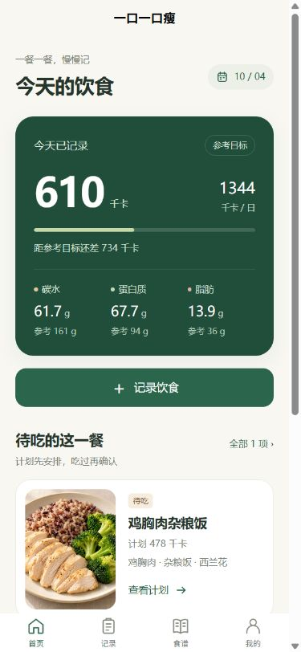
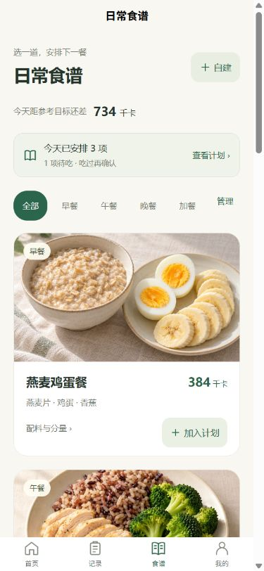
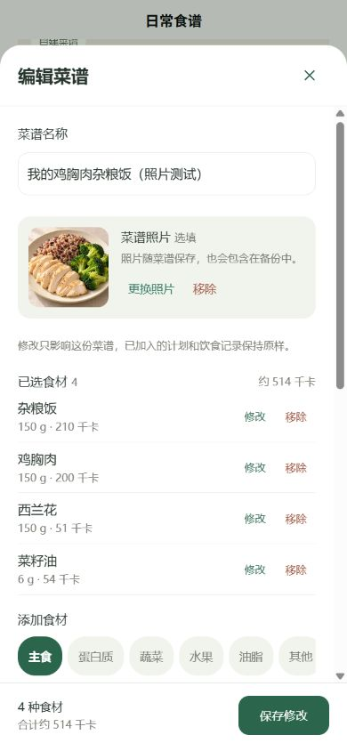
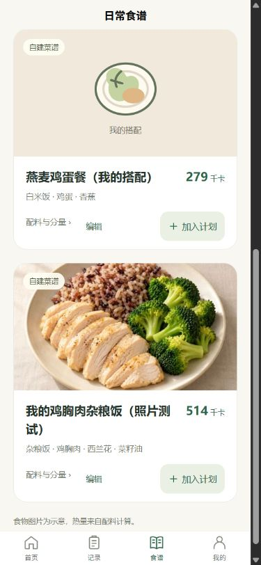

# 一口一口瘦

**把「计划吃什么—实际吃了什么—回看记录」整理成清楚的一餐。**

饮食计划、摄入记录与食谱管理微信小程序。支持按整道菜操作、编辑自己的食谱与照片，以及本地备份恢复。

**第二版已于 2026 年 10 月 14 日通过微信审核并上线。**

**uni-app · Vue 3 · TypeScript · Pinia · Vite · 本地存储**

[作品集展示](https://lsc-261013.github.io/lv-shuaichao-portfolio/) · [界面截图](#界面截图) · [本地运行](#本地运行) · [历史迭代记录](README-history-2026-10-05.md)

## 项目状态

- **微信版：**第二版已上线，发布状态由项目作者确认。
- **本仓库：**提供源码、H5 实际运行截图和迭代记录。仓库源码与微信线上包尚未逐项核对，不能据此认定仓库包含全部线上改动。
- **使用方式：**数据保存在本地，没有账号、业务后端或云同步；推荐使用规则计算，没有运行时大模型调用。

## 核心功能

| 场景 | 已实现的操作 |
| --- | --- |
| **安排一餐** | 计划按整道菜分组，配料按需展开；支持多选、全选、批量确认已吃、撤回与移除 |
| **记录实际摄入** | 待吃与已吃分开统计；已吃按菜份展示，支持逐食材改量、合计变化预览、撤销、历史查看与补记 |
| **维护自己的食谱** | 编辑名称、配料、克数、餐次与照片；分类查看、隐藏与恢复，批量删除内置或自建食谱 |
| **调整食材与分量** | 替换食材前预览热量变化，确认后保存；支持自定义食材、千卡 / 千焦换算，营养信息可选填 |
| **保留与迁移记录** | 编辑或删除源食谱后保留既有计划与摄入记录；支持 JSON 备份、导入预览、合并或完整恢复、导入前副本与文本出口 |

## 几个重点交互

- **计划不提前算成已吃。** 确认食用后才进入实际摄入，撤回与移除分别对应不同操作；移除计划不会删除已吃记录。
- **一道菜保持完整。** 计划与已吃按菜份组织，底层保留逐食材记录与计算，既能看整餐，也能精确修改分量。
- **改食谱不改过去。** 食谱编辑与删除保留历史计划、摄入的名称及数值；历史配图可能随源照片清理而回到默认图。
- **缺失信息清楚呈现。** 未填写身体资料也能记录；没有目标时不虚构完成百分比，未知营养显示“未完善”。

## 界面截图

以下为仓库保留的 **390px 宽 H5 实际运行截图**，使用独立合成测试数据。它们是历史版本的界面记录，不是微信真机截图或正式版逐屏截图；不同截图的数值不代表同一时刻的数据。

| 首页 · 摄入概览与待吃计划 | 食谱 · 图文列表 |
| --- | --- |
|  |  |

| 自建食谱 · 照片与配料编辑 | 自建食谱 · 卡片与加入入口 |
| --- | --- |
|  |  |

[更多截图与来源说明](docs/screenshots/README.md) · [食物图片与图标素材](docs/VISUAL-ASSETS.md)

## 本地运行

安装依赖并启动 H5：

```bash
npm ci
npm run dev -- --host 127.0.0.1
```

默认访问 `http://127.0.0.1:5173`，实际端口以终端输出为准。历史记录的验证环境为 Node.js 24.15.0 / npm 11.12.1。

类型检查、测试与构建：

```bash
npm run typecheck
npm test
npm run build
npm run build:mp-weixin
```

微信开发者工具导入 `dist/build/mp-weixin` 并使用自己的 AppID。源码 `src/manifest.json` 中 AppID 为空，编译产物需在本地生成。

H5 数据按浏览器与来源隔离，切换端口或设备后不会自动出现原记录；迁移前请先导出备份。

## 数据与验证说明

- 数据存储在本机，照片随备份保存。清缓存、换设备前，应把备份保存到应用外。
- 仓库历史 R12 记录（2026-10-05）包含 **209 项测试通过**、类型检查、H5 构建与微信小程序编译通过，以及 H5 页面操作记录。详见 [R12 交接](ROUND12-ALL-RECIPE-DELETION-HANDOFF.md)。
- 上述数字是该次历史检查结果，本次 README 更新没有重新运行测试。H5 检查与小程序编译不能替代真机验证。
- 微信第二版已上线；真实旧数据升级、真机权限、键盘与文件流程的完整验收范围仍需进一步核对。

## 我的参与与协作方式

我负责提出需求、比较并确定交互方案、实际试用与反馈、阶段取舍及发布参与。例如：要求待吃与已吃分离、食谱按整道菜组织、隐藏与现有食谱分类管理，以及删除源食谱后保留历史记录。

项目采用 AI 协作开发，AI 承担主要代码实现、排错、自动化测试与文档整理。这里展示的是持续迭代形成的产品成果。

## 项目记录

- [原 README 完整归档（截至 2026-10-05）](README-history-2026-10-05.md)：保留 R8—R12 说明、历史测试结果、数据细节及各轮交接入口。
- [历史需求与验收文档（R12）](docs/PRD.md)
- [R12：内置与自建食谱统一删除、旧数据兼容](ROUND12-ALL-RECIPE-DELETION-HANDOFF.md)
- [R11：现有食谱管理与已吃菜份](ROUND11-EXISTING-INTAKE-HANDOFF.md)
- [R10：食材替换预览、照片管理与待吃提示](ROUND10-INTERACTION-HANDOFF.md)

历史文档中的“未提审”“未发布”描述当时状态；微信第二版上线信息以本页的项目状态为准。历史检查记录仍按各自日期与范围理解。

---

作者：[吕帅超](https://github.com/lsc-261013) · [更多作品](https://lsc-261013.github.io/lv-shuaichao-portfolio/)

README 更新：2026-10-15
